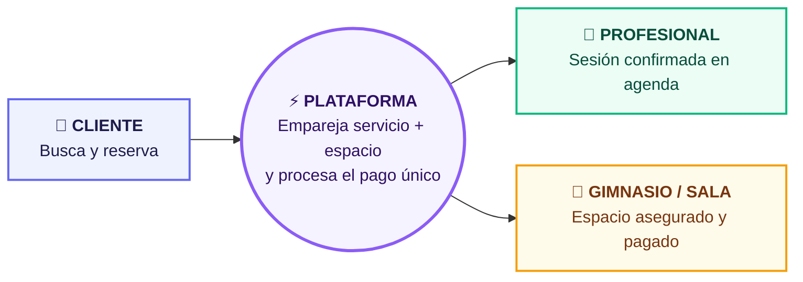

<div align="center">


# 🏋️‍♀️ Plataforma de Bienestar, Profesionales y Espacios


### _El punto de encuentro donde entrenar, cuidarse y encontrar el lugar perfecto ocurre en un solo clic._


<br/>

[](#)
[](#)
[](#)
[](#)

<br/>

---

### 🌟 Descubre un profesional. Reserva tu sesión. La app se encarga del espacio.

</div>

<br/>

## 💡 ¿Qué es la aplicación?

Es una **plataforma web integral** creada para conectar a personas que buscan servicios de salud, bienestar y entrenamiento personalizado (entrenadores personales, fisioterapeutas, profesores de yoga o pilates, podólogos, nutricionistas y masajistas) con profesionales cualificados.

Su gran diferencial es que **elimina la fricción de encontrar dónde realizar la sesión**:
Cuando un servicio no se realiza a domicilio ni online, la aplicación **localiza, empareja y reserva automáticamente una sala o gimnasio compatible**, calcula tiempos reales de viaje entre citas y consolida todo en **un único checkout transparente**.

<br/>




<br/>

---

## 🎯 Los 3 Protagonistas

<table>
  <thead>
    <tr>
      <th width="33%" align="center">
        <h3>👤 Cliente</h3>
        <p><i>Para quien busca cuidarse</i></p>
      </th>
      <th width="33%" align="center">
        <h3>🧘 Profesional</h3>
        <p><i>Para quien presta el servicio</i></p>
      </th>
      <th width="33%" align="center">
        <h3>🏢 Espacio / Gimnasio</h3>
        <p><i>Para quien ofrece instalaciones</i></p>
      </th>
    </tr>
  </thead>
  <tbody>
    <tr valign="top">
      <td>
        <ul>
          <li><b>Búsqueda inteligente:</b> Por disciplina, fecha, hora y ubicación preferida.</li>
          <li><b>Flexibilidad total:</b> Elige entrenar a domicilio, en sala privada, en gimnasio u online.</li>
          <li><b>Checkout en 1 paso:</b> Un solo pago seguro y confirmación inmediata sin esperas.</li>
          <li><b>Bienvenida gratis:</b> Primera entrada libre en gimnasios asociados para nuevos clientes.</li>
        </ul>
      </td>
      <td>
        <ul>
          <li><b>Cero gestión de salas:</b> La app le asigna el espacio adecuado según sus necesidades técnicas.</li>
          <li><b>La agenda manda:</b> Calcula automáticamente desplazamientos entre citas para no solapar tiempos.</li>
          <li><b>Control total:</b> Define su radio de acción en km, tarifas y modalidades.</li>
          <li><b>Cobros automáticos:</b> Liquidaciones directas y transparentes tras cada sesión.</li>
        </ul>
      </td>
      <td>
        <ul>
          <li><b>Monetización de huecos:</b> Alquila salas, cabinas o accesos libres sin esfuerzo manual.</li>
          <li><b>Nuevos usuarios:</b> Atrae clientes cualificados y profesionales recurrentes a sus instalaciones.</li>
          <li><b>Control de aforo:</b> Gestión de inventario sincronizado con reservas automáticas.</li>
          <li><b>Instrucciones seguras:</b> Códigos de acceso compartidos solo con citas confirmadas.</li>
        </ul>
      </td>
    </tr>
  </tbody>
</table>

<br/>

---

## ✨ Lo que hace única a la experiencia

> [!TIP]
> **Sin llamadas ni coordinación manual:** El cliente no tiene que llamar al gimnasio para ver si hay sala libre, ni el entrenador tiene que cuadrar llaves o alquileres. La plataforma sincroniza ambos calendarios al instante.

* 💳 **Checkout Transparente en 4 Partidas:** Un único cargo visible con el desglose exacto de:
  `Servicio del Profesional` + `Comisión del Servicio` + `Alquiler del Espacio` + `Comisión del Espacio`.
* 🚗 **Desplazamientos Reales entre Sesiones:** El motor garantiza que el profesional disponga de tiempo suficiente para finalizar su sesión anterior, trasladarse y preparar la siguiente cita con holgura.
* 📅 **Formatos Flexibles:**
  * **Citas individuales** puntuales.
  * **Series recurrentes** (ej. todos los martes y jueves).
  * **Packs de varias fechas** seleccionadas a la carta.
  * **Clases grupales** (CrossFit, Pilates, Yoga) con control de plazas y lista de espera.
* 🎁 **Entrada de Cortesía en Gimnasios:** Si un cliente nunca ha visitado un gimnasio de la red, su primer acceso a la sala para entrenar con su profesional es gratuito.
* ⚡ **Confirmación Inmediata:** Pagado = Confirmado. Espacio y profesional quedan asegurados en tiempo real.

<br/>

---

<div align="center">

<sub>Desarrollado con altos estándares de privacidad, seguridad y diseño artesanal.</sub>

</div>
```
